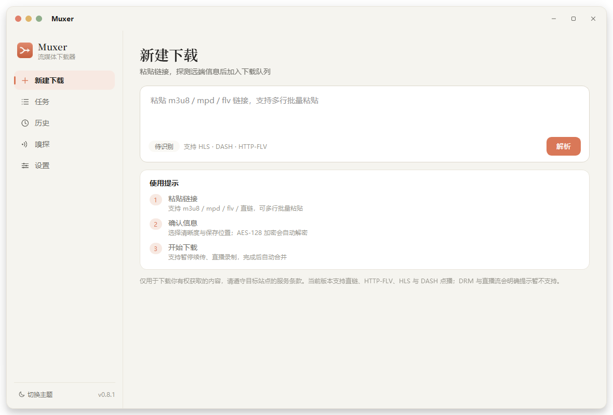
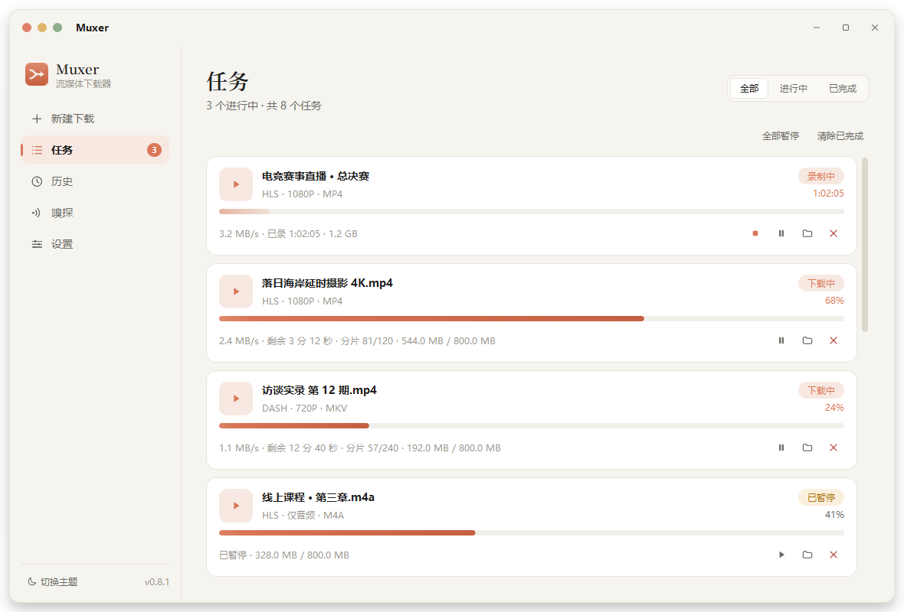
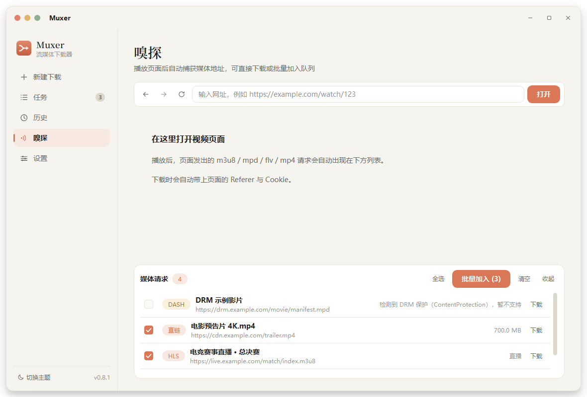
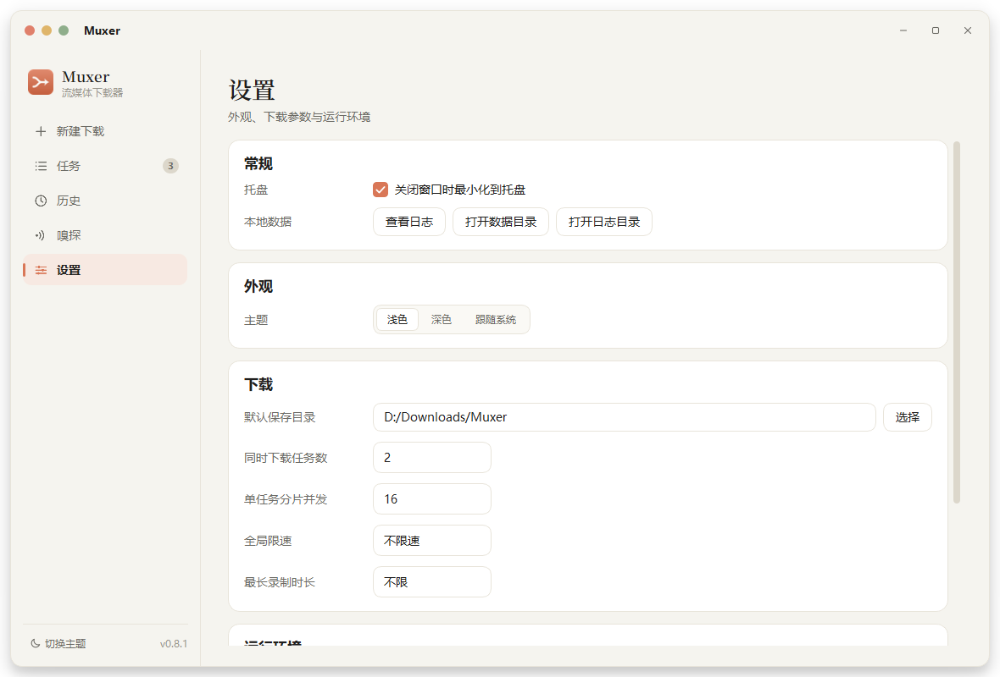
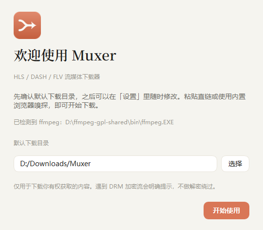
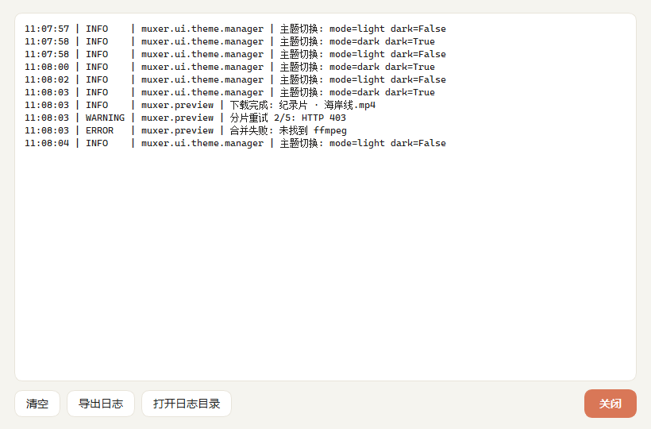

# Muxer

HLS / DASH / FLV 流媒体下载器，PySide6 桌面应用，界面采用 Claude Desktop 风格。

> 仅用于下载你有权获取的内容。遇到 DRM 加密流会明确提示且不做解密绕过。

## 当前进度

| 阶段 | 状态 | 内容 |
|---|---|---|
| M1 | 已完成 | 项目骨架、设计令牌与 QSS 体系、无边框主窗、侧边栏、5 个页面、Toast、任务卡片 |
| M2 | 已完成 | 引擎线程、HTTP 层、任务状态机、SQLite 持久化、真实进度事件、暂停 / 续传 / 取消、URL 探测（直链、FLV） |
| M3 | 已完成 | HLS：master/media 解析、码率变体、独立音轨、AES-128 解密、并发分片、断点续传、ffmpeg 合并 |
| M4 | 已完成 | DASH：MPD 解析、SegmentTemplate/Timeline/List、音视频轨分别下载合并、DRM 与直播识别 |
| M5 | 已完成 | 直播录制：HLS 滑动窗口轮询、HTTP-FLV 持续录制、手动完成、时长上限、录制中界面 |
| M6 | 已完成 | 链接嗅探：内置浏览器、媒体请求拦截、探测与去重、Referer / Cookie 继承、单个与批量下载 |
| M7 | 已完成 | 托盘与单实例、首次启动引导、历史重新下载、设置收尾、PyInstaller 打包与版本信息 |
| M8 | 已完成 | 运行日志查看 / 导出、清空历史、友好错误文案、使用提示与卡片动画、0.8.1 修复 FLV 直播识别并重新打包 |

当前可直接下载 **直链**、**HTTP-FLV**、**HLS 点播**（含 AES-128、fMP4、独立音轨）、
**DASH 点播**（SegmentTemplate / Timeline / List、音视频分轨合并），支持 **HLS / FLV 直播录制**，
并内置浏览器嗅探播放页面中的媒体地址。

## 环境要求

- Python 3.10+
- PySide6 6.8–6.10
- ffmpeg / ffprobe（HLS / DASH 合并、FLV 转封装需要；开发期从 PATH 读取）

## 快速开始

```bash
pip install -r requirements.txt
python -m muxer
```

## 当前能力

- 粘贴链接后由引擎发 HEAD 探测：文件名、大小、类型、协议；HLS 还会解析变体、时长与加密状态
- 直链 / FLV 下载：64KB 分块流式写入、断点续传、指数退避重试
- HLS 点播：master/media 列表、码率选择、EXT-X-MAP / BYTERANGE、AES-128、独立音轨分离与合流、分片级失败重试
- HLS 断点续传：已完成分片落盘，暂停 / 重启后跳过已有文件
- DASH 点播：MPD 解析（含模板继承、BaseURL 继承、SegmentTimeline `r=-1`）、各层 URL 展开、
  SegmentList、单文件 BaseURL 回退；视频 / 音频分别下载后 `-c copy` 合流
- DASH 保护识别：`ContentProtection`（DRM）与 `type="dynamic"`（DASH 直播）明确提示不支持
- 直播录制：
  - HLS：按 target duration 轮询媒体列表，按 MEDIA-SEQUENCE 去重、支持滑动窗口与 ENDLIST 自动收尾；
    AES-128 直播分片同样可解密；独立音轨并行录制后合流
  - HTTP-FLV：持续读取直至手动完成 / 时长上限 / 连接反复中断，结束后重新封装为 MP4
  - 任务卡显示"录制中"、已录时长与移动光带；点击方形停止按钮完成录制并合并
  - 设置页可配置最长录制时长（分钟，0 不限）
- 体验打磨：
  - 设置页可打开运行日志窗口，支持实时查看、清空与导出；日志缓冲上限 2000 行
  - 历史页支持一键清空完成 / 失败记录（二次确认），任务页与数据库同步清理
  - HTTP 404 / 403 / 429 等错误转换为可读中文提示
  - 新建下载页提供三步使用提示，新任务卡片淡入
- 桌面集成：
  - 关闭窗口最小化到托盘，托盘菜单可显示窗口 / 暂停全部 / 退出；后台完成时弹系统通知
  - 单实例：重复启动会唤醒已有窗口（QLockFile 互斥 + 本地套接字激活）
  - 首次启动引导：确认下载目录、显示 ffmpeg 检测结果
  - 历史记录支持"重新下载"，沿用原请求头与协议
  - 设置页新增托盘开关、数据目录 / 日志目录快捷入口
- 链接嗅探：
  - 内置 QtWebEngine 浏览器，可按扩展名与查询参数捕获 m3u8 / mpd / flv / mp4 请求
  - 命中后交给引擎探测真实类型、大小、时长、清晰度与直播 / DRM 状态
  - 自动继承请求的 Referer 与 Cookie；浏览器使用持久 Profile，登录态可跨重启保留
  - 单条可填到新建下载页手动确认；勾选多条可"批量加入"，由引擎探测后以最佳清晰度入队
  - 分片（.ts/.m4s）与图片等高频请求默认忽略，按 URL 去重
- 合并阶段：`POSTPROCESSING` 状态 + ffmpeg `-c copy`，不重编码
- 任务队列：可配置并发（下次启动生效）、暂停、继续、取消、清除已完成
- 实时进度：速度、剩余时间、已下载 / 总大小，节流 5 次/秒推送到界面
- 持久化：任务状态存 SQLite；重启后进行中的任务自动转为可续传的暂停状态
- 全局限速：设置页修改立即生效（令牌桶）
- 历史页：完成 / 失败记录按日期分组，可搜索、可打开文件位置

## 数据位置

| 内容 | 路径 |
|---|---|
| 配置 | `%LOCALAPPDATA%/Muxer/config.json` |
| 任务数据库 | `%LOCALAPPDATA%/Muxer/muxer.db` |
| 任务临时目录 | `%LOCALAPPDATA%/Muxer/tasks/<task_id>/`（HLS 分片在 `video/`、`audio/`） |
| 嗅探浏览器数据 | `%LOCALAPPDATA%/Muxer/webengine/`（Cookie、缓存） |
| 日志 | `%LOCALAPPDATA%/Muxer/logs/app.log`（5MB 滚动 ×3） |

## 打包

```bash
python tools/build_exe.py
```

产物为 `dist/Muxer/Muxer.exe`（onedir）。构建后可用冒烟模式验证启动：

```bash
dist\Muxer\Muxer.exe --smoke-test
```

- 可选内置 ffmpeg：把 LGPL 构建放到 `vendor/ffmpeg/bin/`（`ffmpeg.exe` / `ffprobe.exe` / DLL），
  spec 会自动打包到 `_internal/ffmpeg/`；运行期优先使用内置版本
- WebEngine 资源由 PyInstaller 钩子收集；本机产物约 577 MB（`Muxer.exe` 6.7 MB + `_internal` 570 MB），属于正常体积
- 为规避 Python 3.10 + PyInstaller 6.20 对可选包 rich / PIL 的字节码扫描崩溃，spec 中排除了这两个应用未使用的包
- 版本资源来自 `packaging/version_info.txt`，图标为 `muxer/assets/icons/muxer.ico`

## 测试

```bash
python -m unittest discover -s tests -t . -v
```

61 个用例，覆盖：直链完整下载、暂停 / 续传、取消清理、只读探测、重启恢复、归档、SQLite 读写；
HLS 主 / 媒体列表解析、AES-128 解密、fMP4、独立音轨合流、变体选择、分片续传；
DASH MPD 解析（模板展开、Timeline 重复、继承、SegmentList、单文件回退、DRM / 直播识别）、
端到端下载合并、变体选择与探测；
直播：HLS 滑动窗口轮询 / ENDLIST 自动完成 / 手动停止 / 时长上限，FLV 直播停止与点播转封装；
嗅探：URL 过滤规则、探测并入队、DRM 拒绝；
打磨：HTTP 错误文案、历史清理、日志缓冲；
HLS / DASH / 直播端到端均用 ffmpeg 现场生成样例，由本地静态服务提供，不依赖外网。
缺少 ffmpeg 时协议端到端用例自动跳过。

## 开发工具

| 命令 | 作用 |
|---|---|
| `python tools/build_icon.py` | 由矢量几何重新生成全部 PNG / ICO 图标 |
| `python tools/preview.py` | 离屏渲染 5 个页面浅色 / 深色截图到 `docs/preview-*.png`（注入演示数据，不启动引擎） |
| `python -m compileall muxer tools tests` | 语法检查 |

## 目录

```
muxer/
├── app.py                  # QApplication、日志、主题初始化
├── config.py               # 配置模型与持久化
├── core/                   # 纯 asyncio 内核，不依赖 Qt
│   ├── engine.py           # QThread 宿主 + 线程安全命令 / 事件
│   ├── scheduler.py        # 队列、并发、状态机
│   ├── http.py             # aiohttp 会话、重试、探测、Range 流
│   ├── ffmpeg.py           # ffmpeg 定位、concat / mux / remux、进度解析
│   ├── storage.py          # SQLite 任务表
│   ├── models.py           # 状态、记录、快照、探测结果
│   ├── progress.py         # 速度 / 剩余时间
│   ├── ratelimit.py        # 全局令牌桶
│   ├── files.py            # 文件名与磁盘工具
│   └── events.py           # 引擎 → UI 事件
├── protocols/
│   ├── base.py             # 协议源接口与三种控制异常
│   ├── direct.py           # 直链 / FLV 下载实现
│   ├── hls/                # playlist 解析、探测、AES 解密、分片下载与合并
│   ├── dash/               # MPD 解析、计划展开、音视频分轨下载与合并
│   ├── flv/                # HTTP-FLV 点播 / 直播录制与重新封装
│   └── naming.py           # 协议共用的标题 / 变体标签工具
├── sniff/                  # 媒体请求拦截与 URL 过滤
├── ui/                     # 主题、组件、页面、主窗
└── assets/icons/           # 应用图标 + 界面 SVG
```

## 设计约定

- 全部颜色、圆角、字号来自 `muxer/ui/theme/tokens.py`，QSS 里不出现硬编码颜色
- 内核不 import Qt，便于单测；UI 只消费不可变快照，不直接访问内核对象
- 下载线程与 GUI 线程隔离：命令用 `call_soon_threadsafe` 投递，事件用 Qt 信号回推
- 窗口无边框：标题栏拖动、8px 边缘系统级缩放，最大化时自动去掉圆角与外阴影

详细架构、协议支持清单、里程碑与风险见 `docs/设计方案.md`。

## 界面预览

| 新建下载 | 任务队列 | 嗅探 |
|---|---|---|
|  |  |  |

| 设置 | 首次引导 | 运行日志 |
|---|---|---|
|  |  |  |
